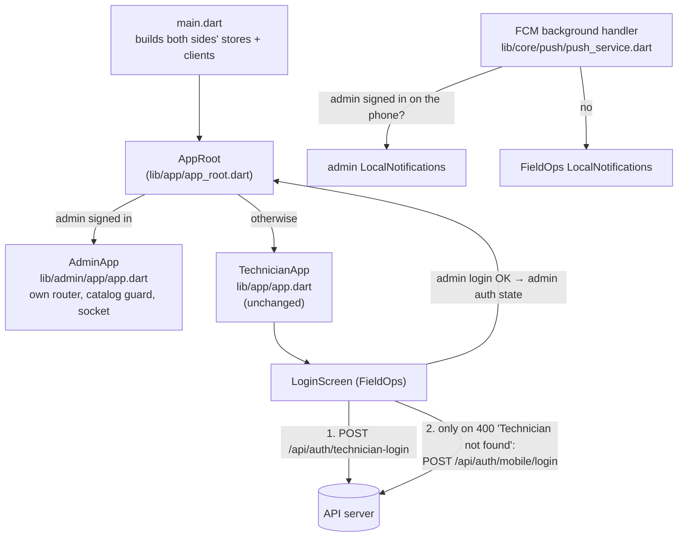

# Admin side: one app for technicians and admins

Since 2026-10-31 FieldOps is the only Fusion Eco phone app (owner: "there will be one and only technician portal"). A **technician** who signs in gets FieldOps as before. An **admin-panel user** (role Admin, Vendor or Tenant — a row in `users`, not `technicians`) gets the admin screens, which were first built as a separate app (`D:\fe_portals\admin_portal`, plan `fusion-eco/FE-mobile.md`) and now live in [`lib/admin/`](../lib/admin/).

## How it fits together



1. **One switch.** `AppRoot` watches the admin side's `authControllerProvider`. Signed in as admin → `AdminApp` (its own `MaterialApp.router`). Anything else → `TechnicianApp`. Signing out of the admin side flips it back to FieldOps' sign-in screen.
2. **One sign-in screen.** FieldOps' [login_screen.dart](../lib/features/login/login_screen.dart) tries the technician login first. Only when the server answers `400 "Technician not found"` (`AuthState.notTechnician`) does it try the admin login (`/api/auth/mobile/login`, FE-mobile.md 0.2). If that fails too, its message replaces ours: an admin's wrong password then reads "Invalid Credentials", not "Technician not found". A technician's wrong password never reaches the admin endpoint, so the admin login audit log stays clean.
3. **Two separate sides.** The admin code keeps its own `ApiClient`, session renewal (`/api/auth/mobile/refresh`), `SessionStore` (`session_user`), router, theme copy and widgets. Its providers are different Dart objects from FieldOps' providers of the same name, so both sit in the one `ProviderScope` (main.dart overrides both sets).
4. **Separate tokens.** The admin keystore entries are `admin_token` / `admin_refresh_token`, not FieldOps' `token` / `refresh_token`. If they shared names, FieldOps' background sync (WorkManager) would send an admin's refresh token to `/api/auth/technician-refresh`. The server would refuse it, and since refresh tokens rotate, it could end the admin's session.
5. **One background push handler.** An app has one. It checks whether an admin is signed in on the phone (`admin.SessionStore.signedInOnDevice()`, which re-reads prefs because the background isolate's copy can be old) and draws the push the way that side does. That way, tapping it lands in the side that is open. Only the signed-in side starts its own push listeners: FieldOps' `PushService.init` needs a technician session, and the admin `PushService.init` runs from `AdminShell`. Once started they stay for the whole run (FCM's streams can't be handed back), so after a technician signs out and an admin signs in on the same run, both sets are alive. Each listener therefore checks the admin `authControllerProvider`: while an admin is signed in only the admin side draws, opens and registers; otherwise only FieldOps does. The notifications plugin is also one per app (one tap callback, one set of iOS button categories), so each side calls its `LocalNotifications.init` again on every sign-in to take it back. Both `init`s skip only the bare call (the one `show` makes); a call that brings a tap handler always runs, or the take-back would do nothing (fixed 2026-10-31, see LEARNINGS).

   Admin alert pushes carry an **Acknowledge** button (Android action, iOS category `fe_alert`). It opens the app rather than acting in the background, so the call runs with the live session:

   ```mermaid
   sequenceDiagram
     participant Tray as Notification tray
     participant LN as admin LocalNotifications
     participant PS as admin PushService.respond
     participant API as POST /api/fm/alerts/:key/acknowledge
     participant UI as Alert detail
     Tray->>LN: tap "Acknowledge" (app opens)
     LN->>PS: payload + actionId fe_alert_ack
     PS->>API: acknowledge
     API-->>PS: alert (or 409 if already acknowledged)
     PS->>UI: open the alert (shows its real status either way)
   ```
6. **Firebase.** Started once, by FieldOps' `main()`. The admin side's old `initFirebase()` is gone. The admin side uses FieldOps' `google-services.json`, so admin alert push (FE-mobile.md 0.4) needs no Firebase app of its own.

## What is shared and what is not

| Piece | Shared | Notes |
|---|---|---|
| Sign-in screen | yes | FieldOps' screen, admin login as the second try |
| Server address (Connection settings) | yes | both clients read `SessionStore.readBaseUrlOverride()` at start-up |
| Translations | yes | one `assets/i18n/{en,ar}.json`. The admin keys are appended as one block at the end. The two that clashed were renamed on the admin side: `more.sign_out_message` and `common.try_again`. |
| Language | yes | one `flutter_localization` singleton; each side has its own `LocaleController` |
| Theme, widgets, network, router | **no** | `lib/admin/` keeps its own copies (they began as copies of FieldOps' own) |
| Offline queue, location check-in gate | **no** | FieldOps only. The gate wraps `TechnicianApp`'s routes, not `AdminApp`'s. |

## Tests

`test/admin/` holds the admin app's tests (imports now `package:technician_portal/admin/...`) and [unified_login_test.dart](../test/admin/unified_login_test.dart), which covers three cases of the shared sign-in: not a technician → admin signed in; an admin's wrong password → the admin message; a technician's wrong password → no admin call.

## History

- The admin app's own notes are in [docs/admin/](admin/): `PENDING.md` (items renumbered A-001…, open ones still owed), `LEARNINGS.md`, `README.md` (its build and push setup at the time).
- The old app folder `D:\fe_portals\admin_portal` (package `com.fusionapps.admin`) was deleted on 2026-11-02 (owner's call); its notes live on in docs/admin/.
